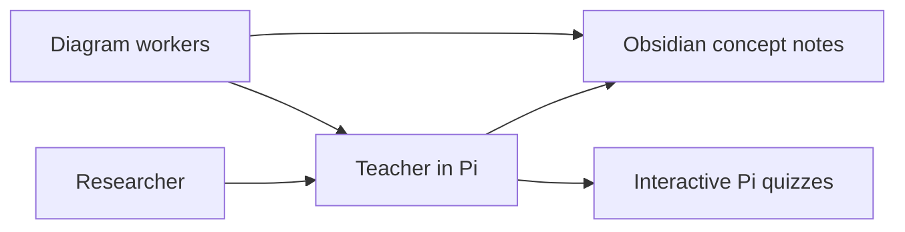

# Pi Learning Setup

Recreate my Pi learning harness on macOS or Linux: the full teaching method,
shared coding preferences, web research, smaller diagram workers, Obsidian
concept notes, persistent learning evidence, and readable math in Pi quizzes.

The installer preserves the original teaching skill byte for byte. It clones a
pinned revision of [amosblomqvist/learn](https://github.com/amosblomqvist/learn)
and adds the local extensions and preferences in this repository. It also pins
[pi-interactive-subagents](https://github.com/amosblomqvist/pi-interactive-subagents).
Exact versions and the full teaching-skill hash are in [upstream-lock.json](upstream-lock.json).



## Set up the MacBook

Run these once, then use `pi-learn` for lessons. Model downloads can be large;
installation downloads weights but does not run a generation or benchmark RAM.

### 1. Install prerequisites

Install [Homebrew](https://brew.sh/) if needed, then:

```bash
brew install git gh python node tmux librsvg ollama
brew install --cask obsidian
npm install -g --ignore-scripts @earendil-works/pi-coding-agent@1.3.0
```

Pi requires Node.js 22.19 or newer. `librsvg` supplies `rsvg-convert`; the installer
handles Mermaid CLI and its browser download. Sources: [Pi installation](https://pi.dev/),
[Homebrew librsvg](https://formulae.brew.sh/formula/librsvg),
[Homebrew Ollama](https://formulae.brew.sh/formula/ollama), [Ollama macOS requirements](https://docs.ollama.com/macos).

Open Obsidian and create/open your existing vault. For the commands below, the
vault is `~/Documents/Notes`; replace that path if yours is elsewhere. The vault
must contain its `.obsidian` directory before running the installer.

### 2. Clone this private repository

```bash
gh auth login
mkdir -p "$HOME/Projects"
cd "$HOME/Projects"
gh repo clone nsavant12/pi-learning-setup
cd pi-learning-setup
```

GitHub and Pi sign-in are machine-specific. No credentials are stored in this repo.

### 3. Install the learning setup

On a fresh Mac, with no other Ollama server running:

```bash
python3 setup.py --vault "$HOME/Documents/Notes" --manage-ollama --install-teacher
```

This creates `Learning/` inside the vault and:

- Installs the full teach skill, research/diagram profiles, notes, math, continuity and review tools.
- Downloads Gemma 4 26B for research and Qwen 3.5 4B for diagrams.
- Downloads the optional Gemma 4 12B teacher with a 32K context **without selecting it**.
- Creates model aliases with explicit context limits, so Pi and Ollama agree.
- Installs a macOS login service with one loaded model and one parallel request.
- Installs `~/.pi/agent/bin/pi-learn` and checks that Pi can load the extensions.
- Preserves the existing teacher selection. Changed configuration is backed up under `~/.pi/agent/backups/`.

`--manage-ollama` owns only its own launch agent. If the Ollama menu-bar app,
Homebrew service, or a manually started server already occupies port 11434, it
stops with instructions instead of killing it. Quit/stop that original launcher
and rerun, or omit `--manage-ollama` to keep using your existing server.
Do not run two Ollama launchers or enable both the menu-bar app's login startup
and this login service.

The login service is `~/Library/LaunchAgents/io.pi-learning.ollama.plist` and
starts automatically at login. You do **not** run `ollama serve` for every lesson.

To omit the optional 12B download, leave out `--install-teacher`. Rerunning the
same setup command is supported; existing notes and learning records remain.

### 4. Choose the main teacher

```bash
~/.pi/agent/bin/pi-learn
```

Inside Pi:

```text
/login
/model
```

For a hosted OpenAI teacher, choose the available ChatGPT subscription sign-in
option under `/login`, then select an available model under `/model`. Press
**Ctrl+S in the model picker** to save the default. Account eligibility and usage
limits apply. [OpenAI subscription sign-in documentation](https://developers.openai.com/cookbook/articles/sign-in-with-chatgpt)

The main teacher can be hosted while the researcher and diagram workers stay
local. To use the optional local teacher later, select **pi-teacher:12b-32k** in
`/model`; setup never selects it automatically.

Start with `/skill:teach` and your topic, or paste [the resume prompt](templates/resume-learning.md).
Set the coding-project path in `Learning/Learner.md` for this Mac. The example
prompt continues the `local_ai` roadmap with RMSNorm; edit it for another topic.

## Daily use

```bash
~/.pi/agent/bin/pi-learn
```

No setup scripts are needed for a normal lesson. The launcher opens Obsidian,
links a new concept note and starts/reattaches the `pi-learning` tmux session.
If you already have Pi open after an update, run `/reload`.

- **Concept notes:** definitions, motivated explanations, derivations, examples,
  pitfalls and takeaways. Clarifications update the same concept section.
- **Visuals:** usually zero or one purposeful diagram per concept. Published
  images in `viz/` are embedded with captions; small Mermaid diagrams render
  directly. An architecture overview can be refined as the lesson progresses.
- **Quizzes:** remain interactive in Pi. Questions, choices and feedback render
  supported LaTeX as Unicode, including roots, sums and stacked display fractions.
  Unsupported expressions remain as source. This is not full MathJax typesetting.
- **No transcript notes:** user messages, quiz selections, internal deliberation
  and tool chatter are not automatically copied into the notebook.
- **Progress:** `/learning-progress` shows evidence and due reviews; `/lesson-end`
  asks the teacher to record remaining evidence. Use `/quit` to stop Pi when done.
- **tmux:** Ctrl+B, then D detaches and leaves the session running. Reopen with
  `pi-learn`. Detaching is not the same as quitting Pi or stopping worker sessions.

An older transcript is preserved; the logger opens a separate concept notebook.
Existing transcripts are not automatically converted or erased.

## Model configuration and memory

| Role | Ollama base model | Pi model ID | Context |
|---|---|---|---|
| Main teacher | Selected in Pi | Existing/default selection preserved | Provider/model dependent |
| Researcher | `gemma4:26b` | `ollama/pi-research:26b-16k` | 16,384 |
| SVG / Mermaid workers | `qwen3.5:4b` | `ollama/pi-diagram:4b-16k` | 16,384 |
| Optional teacher | `gemma4:12b` | `ollama/pi-teacher:12b-32k` | 32,768 |

Aliases use the existing model weights. Local worker prompts and Pi metadata
use matching context sizes. One loaded model/request limits simultaneous local
memory use; changing between models can still be slow. The Mac's actual RAM,
GPU allocation and long-session performance have not been benchmarked here.
Gemma 26B is the heaviest worker in this configuration. Select another researcher
model if it does not fit your Mac; do not assume a smaller active parameter
count means smaller resident weights.

To use hosted workers instead, supply model IDs available through your Pi login:

```bash
python3 setup.py --vault "$HOME/Documents/Notes" --skip-models \
  --research-model 'PROVIDER/RESEARCH_MODEL' \
  --diagram-model 'PROVIDER/VISION_MODEL'
```

Replace both IDs. A rendered-diagram worker needs image input and tool support.
`--teacher PROVIDER/MODEL` changes the main default only when explicitly passed.

## Keep learning progress across computers

This is a setup repository, not a backup of personal lessons or conversations.
Sync the Obsidian vault privately to move `Learner.md`, `Progress.md`, `Review.md`,
`Lessons/`, `viz/` and **`.pi/learning-state.json`**. Make sure your sync/copy tool
includes that hidden state file; syncing only visible Markdown loses structured
review evidence. Avoid simultaneous edits from two machines: state merging is
not implemented. Each machine still has its own Pi login and conversation history.

Prefer installing the configuration separately on each machine; do not copy Linux
`node_modules` or browser caches onto the Mac. For an existing synced `.pi` checkout,
rerun setup on the Mac to install its dependencies and local launcher paths.

Shared coding/AI preferences are in [templates/shared-preferences.md](templates/shared-preferences.md).
Lesson goals/pacing belong in the vault's `Learner.md`. Personal training data,
credentials, model weights, sessions, reports and vault history are excluded from
this repository.

## Check or troubleshoot

```bash
python3 doctor.py
python3 doctor.py --web
```

The first command checks extension loading, math tools, continuity and worker-tool
registration without running a model. `--web` also performs actual public search
and source retrieval; blocking/CAPTCHAs are reported as failures. Neither command
proves model tool-calling quality, peak memory use, terminal font rendering or
GUI display. Research tools do not read PDFs or JavaScript-only pages.

For the macOS Ollama service:

```bash
launchctl print "gui/$(id -u)/io.pi-learning.ollama"
tail -n 40 "$HOME/Library/Logs/pi-learning-ollama-error.log"
```

To stop/remove only this service (model files are preserved):

```bash
launchctl bootout "gui/$(id -u)/io.pi-learning.ollama"
rm "$HOME/Library/LaunchAgents/io.pi-learning.ollama.plist"
```

Configuration backups include an `original-path.txt` beside each saved file.
Restore only the files you intend to roll back, then `/reload` Pi.

## Linux or an existing Pi installation

Install Git, Python 3.10+, Node.js 22.19+, npm, tmux and librsvg through your distro,
then install the pinned Pi npm package shown above. Use your existing Ollama
service. For a manually launched server, start it once in a separate terminal:

```bash
OLLAMA_NUM_PARALLEL=1 OLLAMA_MAX_LOADED_MODELS=1 OLLAMA_CONTEXT_LENGTH=16384 ollama serve
```

Then run setup without `--manage-ollama`:

```bash
python3 setup.py --vault "$HOME/Documents/Notes" --install-teacher
```

For an existing managed Pi wrapper, use `--pi /absolute/path/to/pi` if discovery
fails. `--agent-dir` chooses a separate Pi configuration directory. A custom
`--project-name` chooses another folder inside the vault. Updating existing setup
without redownloading dependencies is possible with `--skip-downloads`.

## Verification and upstream code

The included tests use temporary vaults and synthetic quizzes. They check model
selection preservation, exact teaching-skill preservation, configuration backups,
repeat installation, portable launch behavior, quiz grading, math, answer hiding,
concept updates, real SVG rendering/embedding and exclusion of chat from notes.
See [tests/README.md](tests/README.md) for commands and environment setup.

Original learning/visual/quiz code is fetched from its upstream repositories at
installation time; it is not copied into this repository as a new work. Upstream
notices and terms remain with those sources. This repository contains my setup
scripts, extensions, patches and preferences. It deliberately omits earlier
one-off Linux service migration and compact-teaching experiments.
